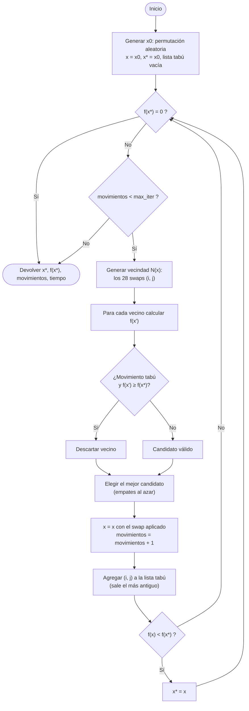

# Problema de las N Reinas resuelto con Búsqueda Tabú

**Materia:** Tópicos Selectos de Inteligencia Artificial · Unidad 2 (Métodos de búsqueda heurísticos para optimización)
**Caso de estudio:** 8 reinas · **Algoritmo:** Búsqueda Tabú con memoria a corto plazo
**Implementación:** `reynas_tabu.py` · **Medición de rendimiento:** `rendimiento.ipynb`

---

## 1. Introducción

El problema de las N reinas consiste en colocar *n* reinas en un tablero de *n × n* de modo que ninguna ataque a otra, es decir, que no haya dos en la misma fila, columna o diagonal. Su versión de 8 reinas fue publicada en 1848 por el ajedrecista Max Bezzel en una revista alemana de ajedrez, y la generalización a *n* reinas apareció después (Bell & Stevens, 2009; Bowtell & Keevash, 2021).

Aunque nació como un acertijo, hoy se usa por tres razones:

1. **Es un banco de pruebas clásico** para técnicas de búsqueda y de satisfacción de restricciones, porque es fácil de enunciar y su espacio de búsqueda crece muy rápido.
2. **Tiene aplicaciones prácticas** en almacenamiento en memorias paralelas, pruebas de circuitos VLSI, control de tráfico y prevención de bloqueos (*deadlocks*) (Bell & Stevens, 2009).
3. **Permite comparar metaheurísticas** (tabú, recocido simulado, algoritmos genéticos) contra métodos exactos en igualdad de condiciones.

Este documento desarrolla la parte teórica de la actividad: describe el problema, lo representa formalmente (P y S), compara las herramientas disponibles para resolverlo, justifica la elección de Búsqueda Tabú, y propone el algoritmo en seudocódigo y diagrama de flujo. La implementación y las métricas están en `reynas_tabu.py` y `rendimiento.ipynb`.

---

## 2. Descripción detallada del problema

### 2.1 Enunciado

Dado un tablero de *n × n*, encontrar una distribución de *n* reinas tal que ningún par se amenace. Una reina amenaza a otra si comparte fila, columna o diagonal (Bell & Stevens, 2009).

### 2.2 Restricciones

| Restricción | Condición de ataque entre las reinas (f₁, c₁) y (f₂, c₂) |
|---|---|
| Fila | f₁ = f₂ |
| Columna | c₁ = c₂ |
| Diagonal descendente | f₁ − c₁ = f₂ − c₂ |
| Diagonal ascendente | f₁ + c₁ = f₂ + c₂ |

Las dos condiciones de diagonal son equivalentes a |f₁ − f₂| = |c₁ − c₂|. Esta es la prueba que se usa en el código.

### 2.3 Tamaño del problema y número de soluciones

Contar posiciones es la mejor forma de ver por qué la representación importa. Para *n* = 8:

| Forma de representar el tablero | Tamaño del espacio |
|---|---|
| Cualquier subconjunto de 8 casillas de 64 | C(64, 8) = 4 426 165 368 |
| Una reina por fila, columna libre | 8⁸ = 16 777 216 |
| **Una reina por fila y por columna (permutación)** | **8! = 40 320** |

Según la OEIS (secuencias A000170 y A002562), el problema tiene 92 soluciones para *n* = 8, o 12 si se consideran equivalentes las rotaciones y reflexiones. La siguiente tabla muestra cómo crece el número total de soluciones *Q(n)* (OEIS, A000170); los valores se verificaron además con un conteo propio por *backtracking*:

| n | 4 | 5 | 6 | 7 | 8 | 9 | 10 | 11 | 12 |
|---|---|---|---|---|---|---|---|---|---|
| Q(n) | 2 | 10 | 4 | 40 | 92 | 352 | 724 | 2 680 | 14 200 |

No es monótona al principio (*Q*(6) = 4 < *Q*(5) = 10), aunque crece de forma muy rápida para valores mayores.

### 2.4 Complejidad computacional

Aquí hay un error frecuente que conviene aclarar, porque algunos artículos dicen que "N reinas es NP-completo":

- **Encontrar una solución** para cualquier *n* es fácil: existen construcciones explícitas que la producen en tiempo polinomial (Hoffman, Loessi & Moore, 1969; Bernhardsson, 1991; Bell & Stevens, 2009). Es decir, está en **P**.
- **Contar todas las soluciones** es difícil: no se conoce un método mejor que la búsqueda exhaustiva optimizada, y la secuencia solo se conoce hasta *n* = 27 (Gent, Jefferson & Nightingale, 2017).
- **Completar un tablero parcial** (algunas reinas ya colocadas) sí es **NP-completo y #P-completo** (Gent et al., 2017).

Entonces, ¿para qué usar una metaheurística si existe una fórmula? Porque la actividad pide partir de **un estado aleatorio** y estudiar cómo se comporta la búsqueda, y las construcciones explícitas no exploran el espacio: devuelven una solución fija. El problema se usa aquí como *banco de pruebas* del algoritmo, no porque no haya otra forma de resolverlo.

### 2.5 Variantes

- **Una solución vs. todas las soluciones** (encontrar una sola es mucho más fácil que enumerarlas todas, ver §2.4).
- **Completion:** tablero con reinas ya colocadas (NP-completo).
- **N reinas toroidal:** el tablero se envuelve en sus bordes (Bowtell & Keevash, 2021).
- **Dimensiones superiores:** el tablero es un hipercubo (Kunt, 2024).

---

## 3. Representación

### 3.1 Representaciones posibles

| Representación | Ejemplo (n = 4) | Observaciones |
|---|---|---|
| Matriz de n × n con 1 y 0 | 4 × 4 con cuatro 1 | La más intuitiva, pero desperdicia espacio y permite fila/columna repetidas |
| Vector de columnas, una por fila (sin restricción) | (3, 4, 3, 2) | Elimina colisiones de fila, pero aún permite columnas repetidas |
| **Permutación de 1…n** | **(3, 4, 1, 2)** | Elimina por construcción las colisiones de fila **y** de columna |

Se elige la **permutación**: el índice *i* es la fila de la reina y el valor `x[i]` es su columna. Así el único tipo de colisión posible es la diagonal, lo que simplifica la función objetivo: basta con contar choques en diagonal. De hecho, la OEIS (A000170) describe las soluciones justamente como las permutaciones *p* de 1…*n* tales que |*p*(*j*) − *p*(*i*)| ≠ *j* − *i* para *i* < *j*.

Ejemplo: `x = (3, 4, 1, 2)` para *n* = 4 tiene las colisiones (1,2), (3,4), (1,3) y (2,4), es decir, f(x) = 4. Una solución válida para *n* = 8 es `(1, 5, 8, 6, 3, 7, 2, 4)`.

### 3.2 Definición formal de P y S

**Espacio de soluciones S**

> S = { x = (x₁, …, x₈) : x es una permutación de {1, …, 8} } , |S| = 8! = 40 320

**Función objetivo f** (a minimizar): número de pares de reinas que colisionan en diagonal.

> f(x) = |{ (i, j) : 1 ≤ i < j ≤ 8, |i − j| = |xᵢ − xⱼ| }|

Rango de f: de 0 a C(8, 2) = 28. El valor 28 se alcanza, por ejemplo, con la permutación identidad (todas las reinas en la diagonal principal).

**Problema P**

> P: minimizar f(x) sujeto a x ∈ S

**Solución:** cualquier x ∈ S con f(x) = 0. Son las 92 soluciones del problema.

**Vecindad N(x):** todas las permutaciones que resultan de intercambiar (*swap*) los valores de dos posiciones *i < j*:

> N(x) = { x con xᵢ y xⱼ intercambiados : 1 ≤ i < j ≤ 8 } , |N(x)| = C(8, 2) = 28

Un **movimiento** se identifica con el par (i, j). Este operador (*swap*) tiene la ventaja de que un intercambio **siempre produce otra permutación válida**, por lo que nunca se sale de S.

### 3.3 Forma del paisaje de búsqueda

Se enumeraron las 40 320 permutaciones y se contó cuántas tienen cada valor de f (cálculo propio, no proviene de las fuentes):

| f(x) | 0 | 1 | 2 | 3 | … |
|---|---|---|---|---|---|
| Permutaciones | 92 | 888 | 2 864 | 6 872 | … |

Las soluciones son solo el 0.23 % de S, pero hay muchos estados cercanos a ellas (f = 1 o 2). Esa abundancia de soluciones alcanzables por pequeños cambios es la razón por la que la búsqueda local funciona bien en este problema (ver §4).

---

## 4. Evaluación de herramientas (algoritmos candidatos)

| Algoritmo | Idea | Ventajas | Desventajas |
|---|---|---|---|
| **Backtracking** | Coloca reinas fila por fila y retrocede al detectar conflicto | Completo: encuentra *todas* las soluciones. Garantiza el resultado | Tiempo exponencial. Para *n* grandes es impráctico (Minton et al., 1992) |
| **Construcción explícita** | Fórmula que coloca las reinas según el valor de *n* | Tiempo polinomial. Siempre acierta | No explora ni usa el estado aleatorio; no sirve para la actividad |
| **Escalada (*hill climbing*)** | Se mueve al mejor vecino mientras mejore | Muy simple y rápida | Se detiene en el primer óptimo local. En un prototipo propio resolvió solo ~42 % de 2 000 inicios aleatorios con *n* = 8 |
| **Min-conflicts** | Reubica una reina en conflicto donde cause menos choques | Muy eficiente: resuelve tableros de un millón de reinas (Minton et al., 1992); variantes de búsqueda local con minimización de conflictos también escalan a millones (Sosič & Gu, 1990) | Sin memoria; puede estancarse en mesetas |
| **Recocido simulado** | Acepta soluciones peores con probabilidad e^(−δ/T), con T decreciente (Kirkpatrick et al., 1983) | Escapa de óptimos locales. Base teórica sólida | No usa memoria. Requiere diseñar la secuencia de enfriamiento (T₀, α, L) |
| **Algoritmos genéticos** | Población de soluciones con cruza y mutación | Mantiene diversidad. Paralelizable | Más parámetros (población, cruza, mutación). Excesivo para un caso de 40 320 estados |
| **Búsqueda Tabú** | Mejor vecino no prohibido + memoria a corto plazo (Glover, 1986) | Evita ciclos y escapa de óptimos locales de forma dirigida. Pocos parámetros | Evalúa toda la vecindad en cada iteración (costo por paso). Depende del tamaño de la lista tabú |

**Justificación de la elección.** Se usa Búsqueda Tabú porque lo exige la actividad, pero además encaja bien con el problema: el *swap* sobre permutaciones genera una vecindad pequeña y siempre válida (28 vecinos), de modo que evaluarla completa en cada iteración es barato, y la memoria a corto plazo resuelve justo la debilidad de la escalada, que es quedarse atrapada.

### 4.1 Cómo funciona la Búsqueda Tabú (resumen)

Tabú es una búsqueda local de mejor mejora a la que se añade una memoria a corto plazo: la lista tabú (Glover, 1986; HeuristicLab, s. f.). Su tamaño (*tenencia tabú*) es un parámetro clave del algoritmo. En cada iteración se descartan los vecinos prohibidos por la lista y se acepta el mejor de los restantes, **aunque sea peor que el estado actual**. Esa aceptación de movimientos que empeoran es lo que permite salir de un mínimo local, y la lista tabú evita volver inmediatamente sobre los pasos recién dados.

Los elementos del método (Glover, 1986; Glover & Laguna, 1997):

1. **Solución actual `x`** y **mejor solución `x*`** encontrada.
2. **Vecindad N(x)** (los *swaps*).
3. **Lista tabú:** guarda los últimos movimientos realizados durante `tenencia` iteraciones.
4. **Criterio de aspiración:** un movimiento tabú se permite igual si produce una solución mejor que la mejor conocida `x*`.
5. **Criterio de parada:** solución con f = 0, o máximo de iteraciones.

### 4.2 Aplicaciones prácticas

El problema se ha usado en situaciones reales (Bell & Stevens, 2009; Lombardi, s. f.):

- **Memorias paralelas:** distribuir datos en módulos de modo que accesos simultáneos no choquen (esquemas de almacenamiento sin conflicto).
- **Pruebas de circuitos VLSI:** generar patrones de prueba sin interferencia.
- **Control de tráfico:** asignar rutas o turnos sin cruces.
- **Prevención de bloqueos:** un conjunto de rutas libres de bloqueo equivale a una solución de N reinas.
- **Otros:** redes neuronales, satisfacción de restricciones y procesamiento de imágenes.

Lo que se practica aquí (modelar con permutación, vecindad por *swap*, función objetivo de conflictos, lista tabú) se transfiere directamente a problemas de **asignación y calendarización**, como el JSSP o el agente viajero de esta misma investigación.

---

## 5. Propuesta de algoritmo

### 5.1 Parámetros

| Parámetro | Símbolo | Valor propuesto | Comentario |
|---|---|---|---|
| Tamaño del tablero | `n` | 8 | Configurable |
| Tenencia tabú | `tenencia` | 5 | Debe ser menor que \|N(x)\| = 28 para que siempre haya algún movimiento disponible |
| Iteraciones máximas | `max_iter` | 1 000 | Criterio de parada de respaldo |
| Estado inicial | `x₀` | Permutación aleatoria | Exigido por la actividad |

### 5.2 Seudocódigo

```
ENTRADA: n, tenencia, max_iter, x0 (permutación aleatoria si no se da)

x  ← x0
x* ← x                      // mejor solución encontrada
lista_tabu ← cola vacía de tamaño máximo "tenencia"
movimientos ← 0

MIENTRAS f(x*) > 0 Y movimientos < max_iter HACER
    mejor_mov ← NULO ; mejor_f ← ∞

    PARA CADA par (i, j) con 1 ≤ i < j ≤ n HACER
        x' ← x con las posiciones i y j intercambiadas
        f' ← f(x')

        es_tabu ← (i, j) ∈ lista_tabu
        SI es_tabu Y f' ≥ f(x*) ENTONCES      // aspiración: solo se permite si mejora x*
            continuar con el siguiente par
        FIN SI

        SI f' < mejor_f  (o empata y gana un sorteo)  ENTONCES
            mejor_mov ← (i, j) ; mejor_f ← f'
        FIN SI
    FIN PARA

    SI mejor_mov = NULO ENTONCES  detener     // sin movimientos disponibles
    x ← x con mejor_mov aplicado              // se acepta aunque empeore
    agregar mejor_mov a lista_tabu            // la cola descarta el más antiguo
    movimientos ← movimientos + 1

    SI f(x) < f(x*) ENTONCES  x* ← x
FIN MIENTRAS

DEVOLVER x*, f(x*), movimientos
```

### 5.3 Diagrama de flujo



### 5.4 Análisis de complejidad

Sea *n* el número de reinas.

| Concepto | Costo |
|---|---|
| Tamaño de la vecindad | n(n − 1)/2 = O(n²) |
| Evaluar f completa (todos los pares) | O(n²) |
| **Una iteración, evaluación ingenua** | O(n²) × O(n²) = **O(n⁴)** |
| Una iteración, evaluación incremental (solo se recalculan los pares de las dos reinas movidas) | O(n²) × O(n) = **O(n³)** |
| Memoria | O(n + tenencia) |

Para *n* = 8 el costo ingenuo son 28 vecinos × 28 pares = 784 comparaciones por iteración, perfectamente asumible. La versión ingenua es la más clara para entender y depurar. La evaluación incremental sería una mejora opcional si se quiere escalar a *n* grande en el notebook.

---

## 6. Métricas y plan de experimentos

El código debe medir, por ejecución:

| Métrica | Cómo se obtiene |
|---|---|
| **Cantidad de movimientos** | Contador de *swaps* aceptados (= iteraciones) |
| **Tiempo** | `time.perf_counter()` antes y después de la búsqueda |
| **Éxito** | `f(x*) == 0` |
| **Evaluaciones de f** | Contador de llamadas a la función objetivo (independiente del hardware) |

Plan para `rendimiento.ipynb`:

1. Una ejecución demostrativa con un estado aleatorio, mostrando el tablero inicial y el final.
2. Repetir cientos o miles de ejecuciones con estados aleatorios distintos y reportar tasa de éxito, media, mediana y máximo de movimientos, y tiempo medio.
3. Histograma de movimientos y de tiempos.
4. Barrido de la tenencia tabú (por ejemplo 1, 3, 5, 7, 10, 15, 20).
5. Comparación contra escalada simple (sin lista tabú) para mostrar el efecto de la memoria.
6. Opcional: aumentar *n* (12, 20, 30) para ver el escalamiento.

### Expectativas preliminares (a confirmar en el notebook)

Antes de implementar el código final se hizo un prototipo propio de esta misma estrategia. Estos números **no provienen de ninguna fuente** y deben sustituirse por las mediciones del notebook:

- Con *n* = 8, tenencias de 1 a 20 y 2 000 inicios aleatorios, el prototipo encontró solución en el 100 % de los casos, con unos 4.3 movimientos de media y mediana de 4.
- La tenencia casi no cambia el resultado con *n* = 8, porque el espacio es muy pequeño y denso en soluciones. El efecto de la lista tabú se ve mejor al comparar contra la escalada simple y al aumentar *n*.
- La escalada simple (mejor vecino, sin memoria) resolvió alrededor del 42 % de los inicios aleatorios.

---

## 7. Autoevaluación contra la rúbrica

| Criterio | Dónde se cubre |
|---|---|
| Claridad de la propuesta | §5 (parámetros, seudocódigo y diagrama) |
| Profundidad de la investigación | §2 (historia, conteo, complejidad, variantes) y §3 |
| Introducción | §1 |
| Fuentes de información | §8 (artículos académicos, bases de datos de secuencias y documentación técnica) |
| Calidad de la investigación | §2.4 corrige una confusión común con evidencia de varias fuentes |
| Organización del informe | Secciones 1 a 8 en orden lógico |
| Evaluación de herramientas | §4 (tabla con ventajas y desventajas de siete opciones) |
| Aplicaciones prácticas | §4.2 |
| Análisis de algoritmos | §2.4 (complejidad del problema) y §5.4 (complejidad del algoritmo) |

---

## 8. Referencias

1. Bell, J., & Stevens, B. (2009). A survey of known results and research areas for n-queens. *Discrete Mathematics, 309*(1), 1–31. https://doi.org/10.1016/j.disc.2007.12.043
2. Bernhardsson, B. (1991). Explicit solutions to the n-queens problem for all n. *ACM SIGART Bulletin, 2*(2), 7. https://doi.org/10.1145/122319.122322
3. Bowtell, C., & Keevash, P. (2021). The n-queens problem. *arXiv:2109.08083*. https://arxiv.org/pdf/2109.08083
4. Gent, I. P., Jefferson, C., & Nightingale, P. (2017). Complexity of n-queens completion. *Journal of Artificial Intelligence Research, 59*, 815–848. https://doi.org/10.1613/jair.5512
5. Glover, F. (1986). Future paths for integer programming and links to artificial intelligence. *Computers & Operations Research, 13*(5), 533–549.
6. Glover, F., & Laguna, M. (1997). *Tabu Search*. Kluwer Academic Publishers.
7. HeuristicLab. (s. f.). *Tabu Search* [Wiki]. https://dev.heuristiclab.com/trac.fcgi/wiki/TS
8. Hoffman, E. J., Loessi, J. C., & Moore, R. C. (1969). Constructions for the solution of the m queens problem. *Mathematics Magazine, 42*(2), 66–72.
9. Kirkpatrick, S., Gelatt, C. D., & Vecchi, M. P. (1983). Optimization by simulated annealing. *Science, 220*(4598), 671–680. https://doi.org/10.1126/science.220.4598.671
10. Kunt, T. (2024). The n-queens problem in higher dimensions. *arXiv:2406.06260*. https://arxiv.org/abs/2406.06260
11. Lombardi, M. (s. f.). *The n-Queens Problem* (manual de OR-tools). Universidad de Bolonia. https://lia.disi.unibo.it/Staff/MicheleLombardi/or-tools-doc/user_manual/manual/search_primitives/nqueens.html
12. Minton, S., Johnston, M. D., Philips, A. B., & Laird, P. (1992). Minimizing conflicts: a heuristic repair method for constraint satisfaction and scheduling problems. *Artificial Intelligence, 58*, 161–205. https://doi.org/10.1016/0004-3702(92)90007-K
13. OEIS Foundation. (s. f.). *A000170: Number of ways of placing n nonattacking queens on an n X n board* y *A002562* (soluciones fundamentales). The On-Line Encyclopedia of Integer Sequences. https://oeis.org/A000170
14. Sosič, R., & Gu, J. (1990). A polynomial time algorithm for the n-queens problem. *ACM SIGART Bulletin*. https://doi.org/10.1145/101340.101343

> **Nota:** el conteo de Q(n) por *backtracking* (§2.3), el enumerado de permutaciones por valor de f (§3.3), los números de la comparación con escalada simple (§4) y las expectativas preliminares (§6) son cálculos propios con un prototipo en Python. No provienen de las referencias.